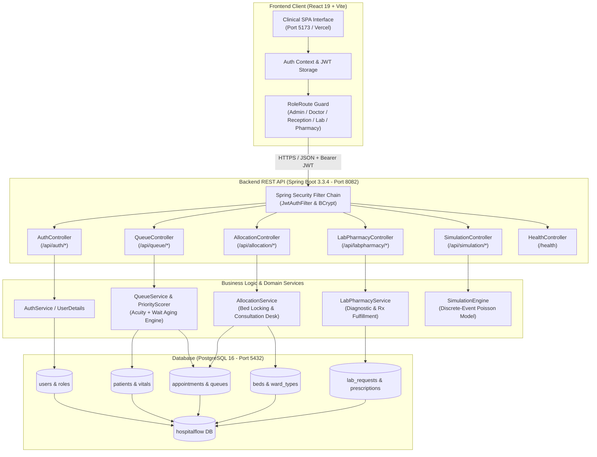

# FlowAlloc — Dynamic Patient Flow and Resource Optimization System

> **“Right patient, right resource, right time.”**

FlowAlloc is an intelligent full-stack hospital outpatient department (OPD) and resource management platform designed to streamline patient intake, prioritize clinical consultations dynamically, allocate ward beds efficiently, and coordinate ancillary services (laboratory, pharmacy, discharge) through unified role-based workflows.

---

## 1. Project Title and Tagline

- **Title**: FlowAlloc — Dynamic Patient Flow and Resource Optimization System
- **Tagline**: *“Right patient, right resource, right time.”*
- **Description**: FlowAlloc coordinates hospital intake, acuity-based queue prioritization, clinical consultations, inpatient bed reservations, diagnostic laboratory workflows, pharmaceutical dispensing, and discharge clearance into an integrated, real-time clinical operations ecosystem.

---

## 2. Problem Statement

Modern hospitals face severe bottlenecks across outpatient and emergency intake pathways:
- **Static First-Come-First-Served (FCFS) Queuing**: Acutely ill patients frequently suffer dangerous delays while waiting behind non-urgent administrative visits.
- **Resource Siloing**: Reception, doctors, laboratory technicians, pharmacists, and ward managers operate on disconnected physical slips or fragmented software tools.
- **Bed Misallocation**: Inpatient beds remain blocked or marked occupied due to delayed manual discharge logging and lack of visibility into real-time ward capacity.
- **Wait-Time Starvation**: Low-acuity patients risk unbounded waiting when urgent arrivals surge, leading to walkouts and operational frustration.
- **Lack of Decision Support**: Clinic leadership lacks empirical data to evaluate how acuity scoring or staffing adjustments impact 90th-percentile patient wait times.

---

## 3. Project Objectives

FlowAlloc delivers measurable operational improvements while adhering strictly to realistic clinical boundaries:
- **Dynamic Acuity & Wait-Time Scoring**: Calculate composite priority scores balancing triage severity (Level 1–4) with linear wait-time aging to prevent starvation.
- **Unified Role-Based Clinical Workspaces**: Give receptionists, doctors, lab technicians, pharmacists, and administrators dedicated dashboards with minimal cognitive overhead.
- **Real-Time Bed State Management**: Maintain atomic bed statuses (`AVAILABLE`, `OCCUPIED`, `MAINTENANCE`) across ICU, General, Emergency, and Step-Down wards with instant allocation during consultation.
- **Closed-Loop Ancillary Tracking**: Track lab orders and prescriptions from creation through specimen processing, dispensing, and final billing clearance before discharge.
- **Simulation-Driven Capacity Planning**: Provide an integrated discrete-event simulation engine comparing FCFS against priority-driven queue algorithms across arrival rates and doctor counts.

---

## 4. Key Features

### Implemented Clinical Modules

| Module | Implementation Status | Functional Description |
| :--- | :--- | :--- |
| **Authentication & RBAC** | ✅ Implemented | JWT token authentication, bcrypt password hashing, and role-based route guards supporting 5 clinical staff roles. |
| **Patient Registration & Check-In** | ✅ Implemented | Receptionist intake form capturing demographics, triage level, chief complaint, vitals (BP, HR, SpO2), and direct queue dispatch. |
| **Dynamic Priority Queue** | ✅ Implemented | Acuity scoring engine combining triage severity with waiting minutes (`Score = BaseSeverity + WaitTimeMinutes`) to prevent starvation. |
| **Doctor Consultation Desk** | ✅ Implemented | Doctor active consultation desk with patient history view, chief complaints, diagnostic notes, direct bed allocation modal, and integrated lab/rx ordering. |
| **Bed Allocation & Ward Board** | ✅ Implemented | Live bed grid categorized by ward type (`GENERAL`, `ICU`, `EMERGENCY`, `STEP_DOWN`) with occupancy tracking and consultation-time reservations. |
| **Laboratory Queue** | ✅ Implemented | Dedicated lab technician desk displaying pending diagnostic requests, test execution timestamps, and completion logging. |
| **Pharmacy Dispensing** | ✅ Implemented | Pharmacist queue tracking pending prescriptions, dosage verification, and real-time dispensation status. |
| **Discharge Ledger** | ✅ Implemented | Bed release ledger identifying admitted patients, confirming discharge clearances, and returning beds to `AVAILABLE` status. |
| **Staff Account Administration** | ✅ Implemented | Administrator panel to provision new medical staff accounts (`/api/auth/staff`), list team members, and manage department assignments. |
| **Discrete-Event Simulation Engine** | ⚙️ Backend Simulated | In-memory synthetic arrival engine (`SimulationEngine.java`) simulating Poisson arrival patterns, comparing FCFS vs. Priority queue metrics (average wait, 90th percentile wait, doctor utilization). |

---

## 5. User Roles and Access Control

FlowAlloc implements strict Role-Based Access Control (RBAC) enforced via Spring Security filters on the backend and route guards on the frontend:

```
ADMIN ──────────> Staff Provisioning, System Auditing, Bed Configuration, Simulation
DOCTOR ─────────> Active Consultation Desk, Bed Assignment, Lab/Rx Ordering
RECEPTIONIST ───> Patient Registration, Vitals Intake, Queue Check-In, Ward Status
LAB_TECH ───────> Diagnostic Worklist, Specimen Tracking, Test Completion
PHARMACIST ─────> Prescription Dispensation, Medication Verification
```

### Role Capabilities Table

| Role Key | Route Workspace | Accessible Capabilities |
| :--- | :--- | :--- |
| `ROLE_ADMIN` | `/admin`, `/simulation` | Create staff accounts, inspect system queues, review ward occupancy, run discrete-event capacity simulations. |
| `ROLE_DOCTOR` | `/doctor` | Call next patient from queue, view clinical vitals, record diagnostic notes, assign inpatient beds, order lab tests, prescribe medications, complete visits. |
| `ROLE_RECEPTIONIST`| `/receptionist` | Register new patients, record triage levels (1–4), assign initial queues, inspect live bed occupancy. |
| `ROLE_LAB_TECH` | `/lab` | View pending lab orders, review patient diagnostic requirements, mark laboratory results as completed. |
| `ROLE_PHARMACIST` | `/pharmacy` | View active prescription queues, review dosage guidelines, mark prescriptions as dispensed. |

*Unauthenticated users attempting to access protected routes are redirected to `/login`. Users attempting to access a route outside their assigned role are redirected to their assigned workspace.*

---

## 6. Technology Stack

### Frontend
- **Framework**: React 19 (`react`, `react-dom`)
- **Build Tool**: Vite 6
- **Routing**: React Router v7 (`react-router-dom`)
- **Styling**: Vanilla CSS with custom clinical design system ("The OPD Ward Board" — paper-register aesthetic, tabular clinical hierarchy, monospaced metrics)
- **Icons**: Lucide React (`lucide-react`)
- **Data Visualization**: Recharts (`recharts`)

### Backend
- **Framework**: Spring Boot 3.3.4
- **Language**: Java 17
- **Security**: Spring Security 6 with stateless JWT (`jjwt-api`, `jjwt-impl`, `jjwt-jackson` 0.12.6)
- **Persistence**: Spring Data JPA / Hibernate
- **Database**: PostgreSQL 16
- **Build Tool**: Apache Maven 3.8+

### Deployment & Infrastructure
- **Containerization**: Multi-stage `Dockerfile` (Eclipse Temurin 17 JRE)
- **Backend Host Configuration**: Render-ready (`render.yaml`, environment port binding via `PORT`)
- **Frontend Host Configuration**: Vercel-ready (`vercel.json` with client-side SPA rewrites)

---

## 7. System Architecture

The following diagram illustrates the flow of requests from the browser through the Spring Boot API layer, service business logic, and PostgreSQL persistence layer:



### Layer Responsibilities
1. **Client Layer**: Manages clinical state, token persistence in local storage, route redirection by role, and responsive form submissions with instant feedback.
2. **Security & API Layer**: Validates JWT cryptographic signatures, extracts user credentials and authorities, handles CORS negotiation, and delegates requests to specialized controllers.
3. **Service Layer**: Executes core domain transactions: calculating dynamic queue priority scores, reserving beds atomically, tracking prescription states, and generating simulation models.
4. **Persistence Layer**: Enforces referential integrity, indexes patient queues, and persists clinical logs across PostgreSQL tables.

---

## 8. Project Structure

```
D:\PatientFlowOptimizationSystem\FSD_HospitalFlow\
├── backend/
│   ├── src/
│   │   ├── main/
│   │   │   ├── java/com/hospitalflow/
│   │   │   │   ├── HospitalFlowApplication.java      # Spring Boot entry point
│   │   │   │   ├── config/                           # Security, JWT & CORS configuration
│   │   │   │   │   ├── JwtAuthFilter.java
│   │   │   │   │   ├── JwtUtil.java
│   │   │   │   │   └── SecurityConfig.java
│   │   │   │   ├── controller/                       # REST API controllers
│   │   │   │   │   ├── AllocationController.java
│   │   │   │   │   ├── AuthController.java
│   │   │   │   │   ├── HealthController.java
│   │   │   │   │   ├── LabPharmacyController.java
│   │   │   │   │   ├── QueueController.java
│   │   │   │   │   └── SimulationController.java
│   │   │   │   ├── dto/                              # Request & Response payloads
│   │   │   │   ├── entity/                           # JPA entities (User, Bed, Patient, etc.)
│   │   │   │   ├── repository/                       # Spring Data JPA repositories
│   │   │   │   ├── service/                          # Business logic & simulation engine
│   │   │   │   │   ├── AllocationService.java
│   │   │   │   │   ├── PriorityScorer.java
│   │   │   │   │   ├── QueueService.java
│   │   │   │   │   └── SimulationEngine.java
│   │   │   │   └── seeder/
│   │   │   │       └── DemoDataSeeder.java           # Automated initial demo data seeder
│   │   │   └── resources/
│   │   │       ├── application.yml                   # Database & application properties
│   │   │       └── schema.sql                        # Optional initial DB schema
│   ├── pom.xml                                       # Maven dependencies & build plugins
│   └── Dockerfile                                    # Multi-stage production container build
├── frontend/
│   ├── src/
│   │   ├── assets/                                   # High-resolution clinical imagery
│   │   ├── components/                               # Shared UI components (BedStatusBadge, etc.)
│   │   ├── context/
│   │   │   └── AuthContext.jsx                       # Authentication state & login lifecycle
│   │   ├── pages/                                    # Role-based workspace pages
│   │   │   ├── AdminDashboard.jsx                    # System oversight & staff management
│   │   │   ├── DoctorDashboard.jsx                   # Active consultation desk
│   │   │   ├── LabDashboard.jsx                      # Diagnostic test worklist
│   │   │   ├── LandingPage.jsx                       # Clinical landing page
│   │   │   ├── LoginPage.jsx                         # Multi-role authentication form
│   │   │   ├── PharmacyDashboard.jsx                 # Prescription fulfillment worklist
│   │   │   ├── ReceptionDashboard.jsx                # Patient registration & queue intake
│   │   │   └── SimulationPage.jsx                    # Queue comparison simulation
│   │   ├── services/
│   │   │   └── api.js                                # Axios/fetch client configuration
│   │   ├── App.jsx                                   # React Router setup & RoleRoute guards
│   │   ├── index.css                                 # Design system styling & design tokens
│   │   └── main.jsx                                  # React entry point
│   ├── public/
│   │   └── favicon.svg                               # OPD Ward Board SVG icon
│   ├── package.json                                  # Frontend dependencies & scripts
│   ├── vite.config.js                                # Vite bundler configuration
│   └── vercel.json                                   # SPA rewrite rules for Vercel
├── render.yaml                                       # Render deployment specification
└── README.md                                         # Main documentation & setup guide
```

---

## 9. Prerequisites

Ensure the following tools are installed on your machine before running FlowAlloc locally:

| Software | Minimum Version | Verification Command |
| :--- | :--- | :--- |
| **Java Development Kit (JDK)** | OpenJDK 17 or higher | `java -version` |
| **Apache Maven** | 3.8.0 or higher | `mvn -v` |
| **Node.js** | 18.0.0 or higher (LTS recommended) | `node -v` |
| **npm** | 9.0.0 or higher | `npm -v` |
| **PostgreSQL** | 15.0 or 16.0 | `psql -U postgres -c "SELECT version();"` |

---

## 10. Installation and Setup

### Step 1: Database Setup (PostgreSQL)

1. Open PostgreSQL command line (`psql`) or pgAdmin:
   ```powershell
   psql -U postgres
   ```
2. Create the target database:
   ```sql
   CREATE DATABASE hospitalflow;
   ```
3. Verify connection:
   ```sql
   \c hospitalflow
   ```

### Step 2: Backend Configuration & Startup

1. Navigate to the backend directory:
   ```powershell
   cd D:\PatientFlowOptimizationSystem\FSD_HospitalFlow\backend
   ```
2. Verify or configure environment variables in `backend/src/main/resources/application.yml`:
   ```yaml
   server:
     port: ${PORT:8082}

   spring:
     datasource:
       url: ${DATABASE_URL:jdbc:postgresql://localhost:5432/hospitalflow}
       username: ${DB_USERNAME:postgres}
       password: ${DB_PASSWORD:postgres}
     jpa:
       hibernate:
         ddl-auto: update
       show-sql: false

   jwt:
     secret: ${JWT_SECRET:404E635266556A586E3272357538782F413F4428472B4B6250645367566B5970}
     expiration: 86400000 # 24 hours
   ```
   > **Note**: For production or cloud deployments, supply your own secure 256-bit base64 secret via `JWT_SECRET`.
3. Build and launch the Spring Boot application:
   ```powershell
   mvn spring-boot:run
   ```
   *The backend will automatically start on `http://localhost:8082` and seed demo users and sample hospital beds on initial boot via `DemoDataSeeder`.*

### Step 3: Frontend Setup & Startup

1. Open a new terminal and navigate to the frontend directory:
   ```powershell
   cd D:\PatientFlowOptimizationSystem\FSD_HospitalFlow\frontend
   ```
2. Install dependencies:
   ```powershell
   npm install
   ```
3. Configure frontend environment variables:
   Create a `.env` file in `frontend/` (or rely on the default fallback):
   ```env
   VITE_API_BASE_URL=http://localhost:8082/api
   ```
4. Start the Vite development server:
   ```powershell
   npm run dev
   ```
   *The frontend will launch on `http://localhost:5173` (or `http://localhost:5174` if port 5173 is occupied).*

---

## 11. Running the Application

### Accessing the System
- **Frontend Application URL**: `http://localhost:5173`
- **Backend Health Check**: `http://localhost:8082/health`
- **Backend API Base**: `http://localhost:8082/api`

### Verified Demo Credentials
The backend seeds the following test accounts automatically on startup. All demo accounts share the same verified development password:

| Role | Username / Email | Password | Primary Workflow |
| :--- | :--- | :--- | :--- |
| **Hospital Administrator** | `admin@patientflow.local` | `Demo@1234` | Staff account provisioning, system queues, capacity simulation |
| **Attending Doctor (Cardiology)** | `doctor1@patientflow.local` | `Demo@1234` | Calling queue, diagnosis notes, bed reservation, ordering lab/rx |
| **Attending Doctor (Internal Med)** | `doctor2@patientflow.local` | `Demo@1234` | Parallel consultation queue management |
| **Receptionist / Triage Desk** | `reception@patientflow.local` | `Demo@1234` | Patient intake, recording vitals, assigning triage urgency |
| **Laboratory Technician** | `lab@patientflow.local` | `Demo@1234` | Processing blood panels and diagnostic orders |
| **Pharmacist** | `pharmacy@patientflow.local` | `Demo@1234` | Reviewing medication orders and dispensing drugs |

---

## 12. API Overview

All protected endpoints require an `Authorization: Bearer <token>` header obtained from `/api/auth/login`.

### Authentication Endpoints (`/api/auth`)
| Method | Endpoint | Required Role | Description |
| :--- | :--- | :--- | :--- |
| `POST` | `/api/auth/login` | Public | Authenticates user; returns JWT token, user name, and role. |
| `POST` | `/api/auth/register` | Public | Registers general users. |
| `POST` | `/api/auth/staff` | `ROLE_ADMIN` | Provisions a new staff account (Doctor, Reception, Lab, Pharmacy). |
| `GET` | `/api/auth/staff` | `ROLE_ADMIN` | Retrieves all registered hospital staff members. |

### Patient & Queue Endpoints (`/api/queue`)
| Method | Endpoint | Required Role | Description |
| :--- | :--- | :--- | :--- |
| `GET` | `/api/queue` | Authenticated | Fetches live queue entries sorted by calculated dynamic priority score. |
| `GET` | `/api/queue/patients` | Authenticated | Lists all registered patient demographic and medical records. |
| `POST` | `/api/queue/checkin` | `ROLE_RECEPTIONIST`, `ROLE_ADMIN` | Checks in a patient with triage level and vital signs. |

### Doctor Consultation & Bed Allocation (`/api/allocation`)
| Method | Endpoint | Required Role | Description |
| :--- | :--- | :--- | :--- |
| `GET` | `/api/allocation/beds` | Authenticated | Lists all hospital beds with ward types and current status. |
| `GET` | `/api/allocation/doctor/me` | `ROLE_DOCTOR` | Returns current doctor's availability status and active patient. |
| `POST` | `/api/allocation/doctor/status` | `ROLE_DOCTOR` | Toggles doctor availability (`AVAILABLE`, `BUSY`, `OFFLINE`). |
| `POST` | `/api/allocation/call-next` | `ROLE_DOCTOR` | Calls the highest-priority waiting patient into active consultation. |
| `POST` | `/api/allocation/appointments/{id}/assign-bed` | `ROLE_DOCTOR`, `ROLE_ADMIN` | Reserves and assigns a specific bed to an admitted patient. |
| `POST` | `/api/allocation/appointments/{id}/complete` | `ROLE_DOCTOR` | Concludes consultation, submits diagnosis, and records lab/rx orders. |

### Diagnostic & Fulfillment Endpoints (`/api/labpharmacy`)
| Method | Endpoint | Required Role | Description |
| :--- | :--- | :--- | :--- |
| `GET` | `/api/labpharmacy/lab-requests/pending` | `ROLE_LAB_TECH`, `ROLE_ADMIN` | Lists pending laboratory test orders. |
| `POST` | `/api/labpharmacy/lab-requests/completed` | `ROLE_LAB_TECH` | Marks a laboratory test request as completed. |
| `GET` | `/api/labpharmacy/prescriptions/pending` | `ROLE_PHARMACIST`, `ROLE_ADMIN` | Lists pending pharmaceutical prescription orders. |
| `POST` | `/api/labpharmacy/prescriptions/dispensed`| `ROLE_PHARMACIST` | Marks an ordered medication as dispensed. |
| `GET` | `/api/labpharmacy/discharge/ready` | Authenticated | Lists patients ready for discharge clearance. |
| `POST` | `/api/labpharmacy/discharge/{id}` | Authenticated | Finalizes patient discharge and frees associated bed to `AVAILABLE`. |

### Simulation & Health Endpoints
| Method | Endpoint | Required Role | Description |
| :--- | :--- | :--- | :--- |
| `POST` | `/api/simulation/run` | Authenticated | Executes discrete-event queue comparison with customizable parameters. |
| `GET` | `/health` | Public | Returns service liveness status (`{"status":"UP"}`). |

---

## 13. Typical Workflow

```
[Patient Intake]               [Consultation]                 [Fulfillment]             [Discharge]
 Receptionist                   Attending Doctor               Lab Tech / Pharmacist     Ward Manager
      │                                │                                │                     │
      ├─ 1. Register Patient Demographics
      ├─ 2. Record Vitals & Triage (L1-L4)
      ├─ 3. Queue with Dynamic Aging
      │                                ├─ 4. Doctor Calls Next Patient
      │                                ├─ 5. Record Diagnosis & Vitals
      │                                ├─ 6. Assign Bed (if Admitted)
      │                                ├─ 7. Order Lab Tests & Prescriptions
      │                                ├─ 8. Complete Consultation
      │                                │                                ├─ 9. Lab Completes Tests
      │                                │                                ├─ 10. Pharmacy Dispenses Meds
      │                                │                                │                     ├─ 11. Discharge Approved
      │                                │                                │                     └─ 12. Bed Released
```

1. **Intake & Triage**: Receptionist logs into `/receptionist`, registers a patient (or selects an existing record), records intake vitals (BP, Heart Rate, Oxygen Saturation), and assigns an Acuity Level (Level 1: Critical to Level 4: Routine).
2. **Dynamic Queue Prioritization**: The system calculates a priority score. Over time, lower-urgency patients gain points via linear aging to avoid wait-time starvation.
3. **Doctor Consultation**: Doctor logs into `/doctor`, marks status as *Available*, and clicks **Call Next Patient**. The highest-scoring patient is loaded into the active consultation card.
4. **Bed Assignment & Orders**: If hospitalization is warranted, the doctor opens the Bed Allocation modal to reserve an available ICU or General bed. The doctor inputs clinical notes, specifies required lab tests (e.g., CBC, Lipid Panel), and prescribes medications.
5. **Ancillary Fulfillment**:
   - Lab Technician at `/lab` picks up the pending test, processes the diagnostic sample, and marks it *Completed*.
   - Pharmacist at `/pharmacy` verifies the drug dosage and clicks *Dispense*.
6. **Discharge & Capacity Recovery**: At `/admin` (or Ward Discharge Ledger), admitted patients who have completed tests and prescriptions are cleared for discharge. Confirming discharge automatically resets the allocated bed back to `AVAILABLE`.

---

## 14. Testing

### Backend Unit & Integration Tests
The backend contains automated tests verifying authentication, queue scoring, and controllers using Spring Boot Test and JUnit 5:
```powershell
cd D:\PatientFlowOptimizationSystem\FSD_HospitalFlow\backend
mvn test
```
*To run without triggering tests during rapid development packaging:*
```powershell
mvn clean package -DskipTests
```

### Frontend Code Quality & Build Validation
The frontend can be validated for syntax correctness, lint rules, and production bundle generation:
```powershell
cd D:\PatientFlowOptimizationSystem\FSD_HospitalFlow\frontend

# Lint check using oxlint or eslint
npx oxlint src

# Production build verification
npm run build
```

---

## 15. Current Limitations and Future Scope

### Current Limitations
- **Polling vs. WebSockets**: Dashboards currently utilize manual refreshes and query polling rather than full-duplex WebSocket / STOMP channels for instant multi-user synchronization.
- **In-Memory Simulation**: The capacity simulation module utilizes a Poisson-based mathematical discrete-event simulation engine in memory rather than reading live historical logs from disk.
- **Single-Facility Scope**: Bed management is organized around department wards (`ICU`, `GENERAL`, `EMERGENCY`, `STEP_DOWN`) within a single facility rather than multi-hospital networks.

### Future Scope
- **Real-Time Push Notifications**: Integrate Spring WebSocket with STOMP to broadcast queue call alerts and bed releases immediately across client browsers.
- **Machine Learning Wait-Time Estimator**: Train a predictive model on historical consultation durations to provide patients with dynamic wait-time SMS updates.
- **HL7 / FHIR Integration**: Add interoperability adapters to ingest Electronic Health Records (EHR) from external hospital information systems.
- **Automated Discharge Billing Gate**: Integrate pharmacy billing settlement triggers before permitting final bed release.

---

## 16. Screenshots and Demo Assets

Visual assets and design references incorporated within the platform:

| Asset | Location in Repository | Description |
| :--- | :--- | :--- |
| **Clinical Hero Photograph** | `frontend/src/assets/Focused Clinician in Modern Hospital Ward.png` | Primary visual element of the landing page hero section. |
| **Ward Board Icon (Favicon)** | `frontend/public/favicon.svg` | Physical OPD ward board inspired SVG favicon with clinical teal palette. |

---

## 17. Contributing / Development Notes

Guidelines for teammates and contributors extending FlowAlloc:

1. **Branching Strategy**: Use feature branches off `main` (`feature/bed-notifications`, `fix/queue-aging`).
2. **Code Conventions**:
   - Backend follows standard Spring Boot conventions: Controllers remain thin, encapsulating business logic inside `@Service` classes.
   - Frontend styling adheres to "The OPD Ward Board" design system defined in `frontend/src/index.css`. Maintain paper-card styling, tabular borders, and monospaced indicators. Avoid adding unnecessary heavy UI libraries.
3. **Environment Security**:
   - Never commit sensitive database passwords, production JWT secrets, or cloud API keys.
   - Always reference environment variables through `${VARIABLE_NAME:fallback}` syntax in `application.yml` and `VITE_` prefixed variables in Vite.
4. **Running Both Servers Simultaneously**:
   - Terminal 1: `cd backend && mvn spring-boot:run`
   - Terminal 2: `cd frontend && npm run dev`
