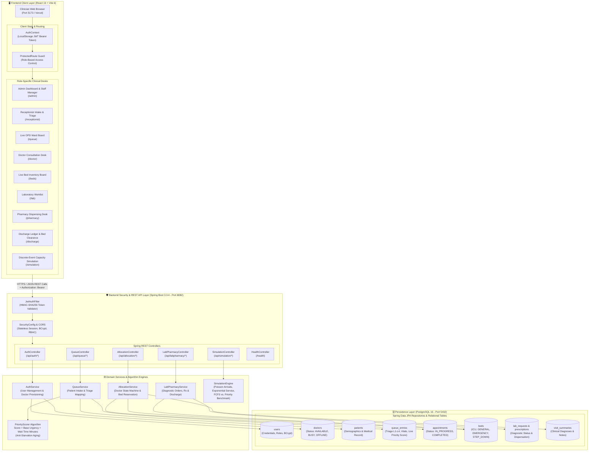
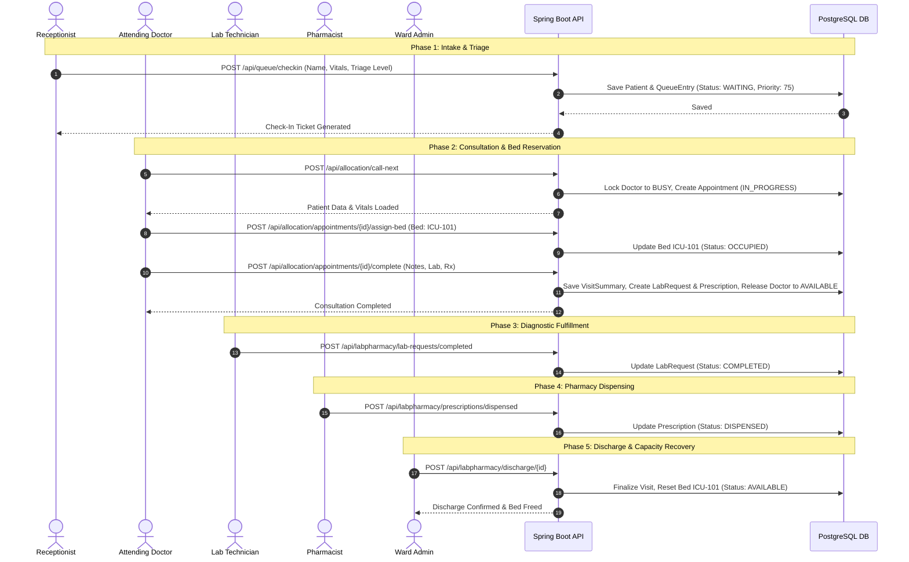

# FlowAlloc — System Architecture & Workflow Specifications

> **System Name:** FlowAlloc — Dynamic Patient Flow and Resource Optimization System  
> **Tagline:** “Right patient, right resource, right time.”  
> **Documentation Type:** Visual Architecture, Component Breakdown & Data Flow Specifications

---

## 1. System Architecture Diagram

---

## 2. Layer-by-Layer Architectural Breakdown

### 2.1 Frontend Client Layer (React 19 + Vite 6)
- **Design Philosophy:** "The OPD Ward Board" — high contrast paper-register styling with monospaced clinical indicators and tabbed navigation.
- **Role Routing:** Managed through `ProtectedRoute.jsx` using React Router v7. Unauthenticated users are redirected to `/login`, while unauthorized roles are bounced back to their respective clinical dashboard.
- **State Management:** React Context API (`AuthContext.jsx`) stores the active user details, roles, and session token in `localStorage`.
- **API Interceptor:** Axios (`api.js`) automatically appends `Authorization: Bearer <token>` to all HTTP requests.

### 2.2 Security & REST API Layer (Spring Boot 3.3.4)
- **Token Filter:** `JwtAuthFilter` extracts Bearer tokens on every incoming request, validates cryptographic HMAC-SHA256 signatures, and injects user permissions into the `SecurityContext`.
- **Role-Based Access Control (RBAC):** Configured in `SecurityConfig.java`:
  - Public endpoints: `/api/auth/login`, `/api/auth/register`, `/health`
  - Admin-only endpoints: `/api/auth/staff/**`
  - Doctor endpoints: `/api/allocation/call-next`, `/api/allocation/appointments/*/complete`
  - Role-specific endpoints for Receptionists, Lab Technicians, and Pharmacists.

### 2.3 Business Logic & Algorithms
- **Dynamic Priority Scoring (`PriorityScorer.java`):**
  $$\text{Priority Score} = \text{Base Acuity Weight}(\text{Triage Level}) + \text{Wait Time in Minutes}$$
  - Level 1 (Resuscitation): Base 100
  - Level 2 (Emergency): Base 75
  - Level 3 (Urgent): Base 50
  - Level 4 (Routine): Base 25
  - Aging rate of $+1.0$ point per elapsed minute guarantees **anti-starvation** for low-urgency patients.
- **Doctor State Machine (`AllocationController.java`):** Enforces atomic transitions between `AVAILABLE` and `BUSY`, ensuring no doctor claims multiple patients simultaneously.
- **Discrete-Event Simulation (`SimulationEngine.java`):** Models Poisson synthetic arrivals to empirically compare 90th percentile wait times between FCFS and Priority queueing policies.

### 2.4 Data Persistence Layer (PostgreSQL 16)
- Relational schema managed by Spring Data JPA with `hibernate.ddl-auto: update`.
- Normalized relational tables mapping patient intake, clinical queues, doctor assignments, hospital bed reservations, diagnostic laboratory orders, and pharmaceutical prescriptions.

---

## 3. End-to-End Clinical Data Flow

---

## 4. Port & Network Topology

| Component | Local Dev Port | Production Host | Protocol |
| :--- | :--- | :--- | :--- |
| **Frontend SPA** | `5173` | Vercel | HTTPS / Web |
| **Backend REST API** | `8082` | Render (Docker) | HTTPS / JSON |
| **PostgreSQL Database** | `5432` | Render Managed PG | PostgreSQL TCP |
| **Health Probe** | `8082/health` | Render Health Check | HTTP GET |
